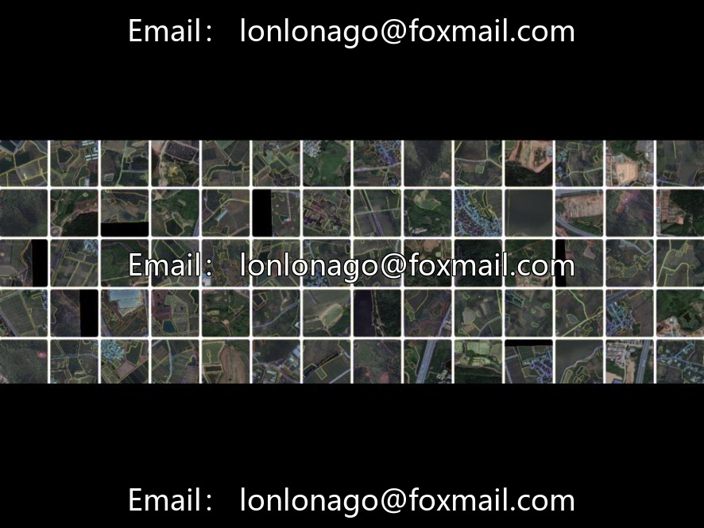
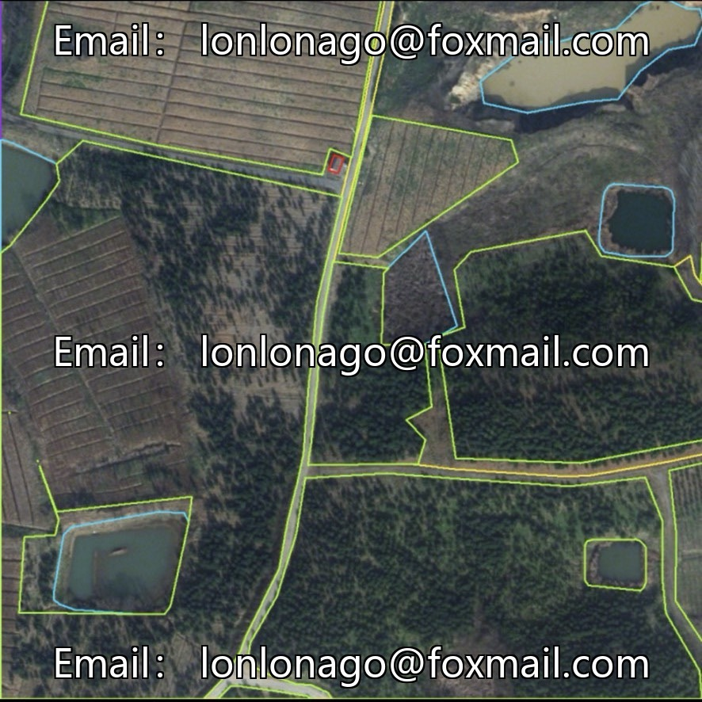
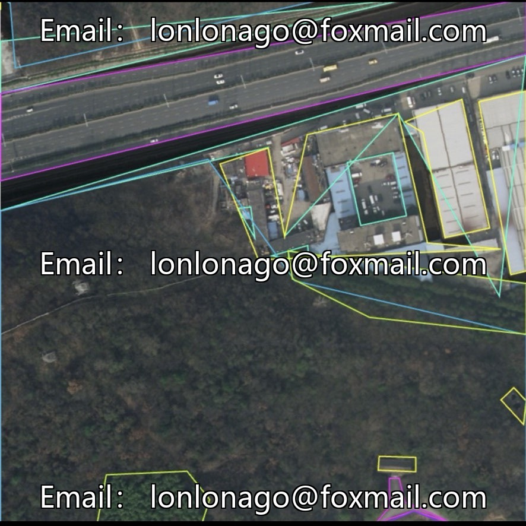
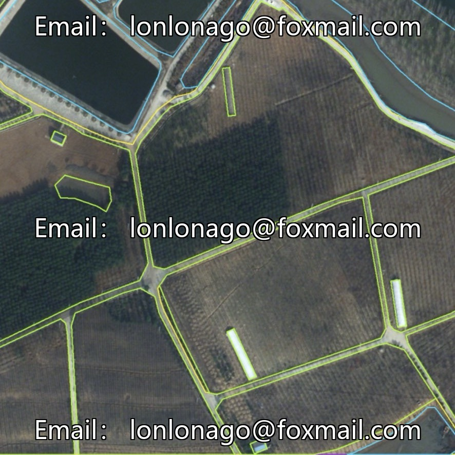
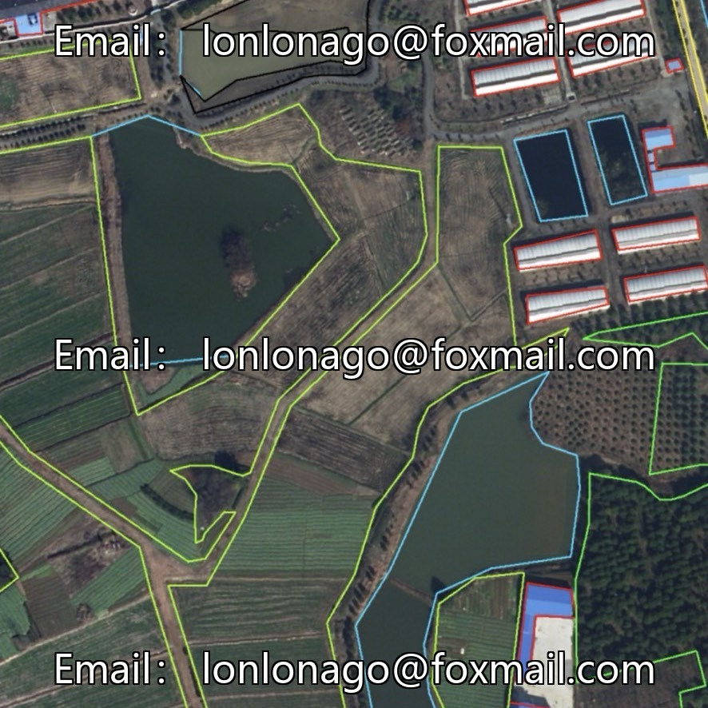
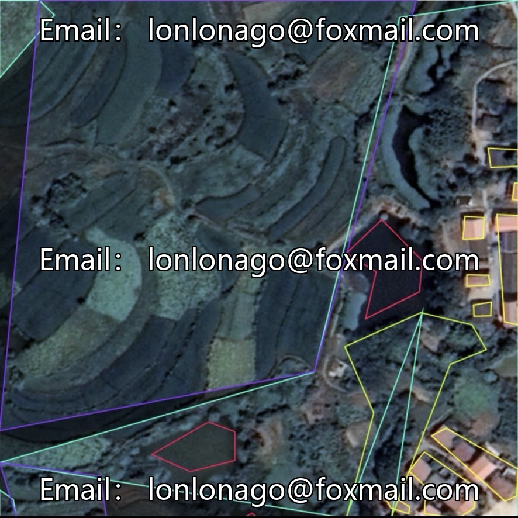
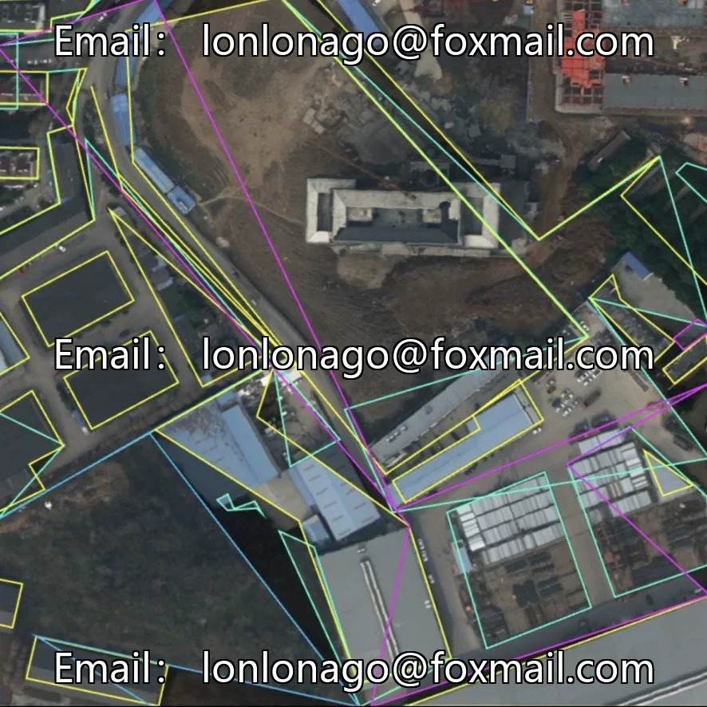

# UAV remote sensing national territory target detection dataset (cultivated land/road/farmland detection), volume 10

## Body

UAV remote sensing national territory target detection dataset (cultivated land/road/farmland detection), issue 10759

The dataset consists of 3,774 aerial panoramic images from high altitudes, covering 8 categories of land surface targets, suitable for land resource surveying, urban and rural planning, and cropland monitoring scenarios.

8 types of land-uses: water, buildings, roads, background, forest, agricultural land, bare land, annotation error zones
Task type: instance segmentation
Annotation format: YOLO / VOC / COCO (polygon mask annotation)
Scene characteristics: covers complete national scene such as urban and rural buildings, farmland, forest, water body, etc., including typical working conditions like vegetation intermingling, dense building, water reflection, blurred boundary of the plot.

Applicable scenarios
For land resource surveying, urban and rural planning, algorithm research, etc., it supports rapid start-up, provides YOLOv8 instance segmentation training example code (26 rounds), the configuration file has preset 8 categories of targets, can be directly run.

Virtual materials, once sold, are non-refundable.
Interested friends, click "I want" to proceed.

## Images

## Payment

Here is a pay link on Stripe ( https://buy.stripe.com/3cs8yP7sY87d0vu9AB ). Please contact me lonlonago@foxmail.com after funding $89, and I will send you a complete data files , thank you!

